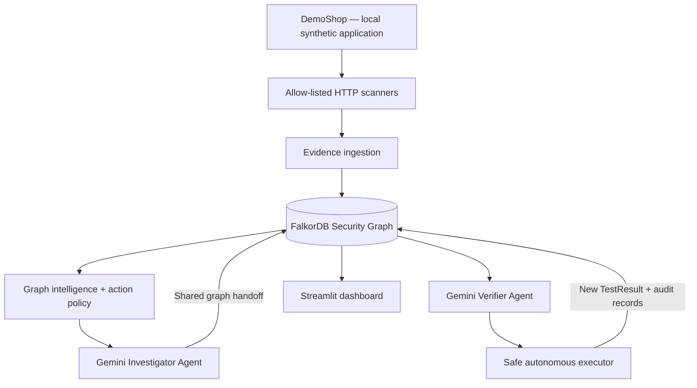
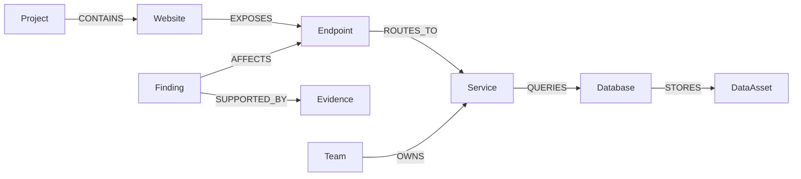

# TraceShield AI
### Graph-Powered Autonomous Security Investigation & Verification

**TraceShield AI** is a defensive security prototype that turns isolated vulnerability findings into **connected, explainable, and actionable investigations**. It combines **FalkorDB**, **Google Gemini**, **LangChain/LangGraph**, safe local security scanners, and a **Streamlit dashboard**.

Instead of only reporting that an endpoint may be vulnerable, TraceShield traces **which service owns it, which database it reaches, which sensitive assets could be affected, which team is responsible, and what authorized verification should happen next**.

> **Hackathon:** Built for the WeMakeDevs × FalkorDB Graph Hacks — *Agents That Act on Connected Data* track.
>
> **Repository:** https://github.com/subhasish52/TraceShield-AI
>
> **Safety:** This is a **local, synthetic-data demonstration**, not a production vulnerability scanner. Autonomous checks are restricted to approved local targets and allow-listed read-only actions.

---

## Key Features

| Capability | What TraceShield AI does |
|---|---|
| **Connected security knowledge graph** | Links websites, endpoints, services, databases, sensitive assets, findings, evidence, projects, and owner teams. |
| **Graph-aware investigation** | Traverses multiple relationships to explain a finding's potential impact. |
| **Contextual risk scoring** | Uses a deterministic **inherent-impact heuristic** to help prioritize investigation. |
| **Finding correlation** | Discovers findings that share endpoints, services, or databases. |
| **AI agent with tools** | Gemini uses LangChain/LangGraph tools to retrieve graph context and reason about evidence. |
| **Graph-directed autonomy** | Selects an approved verification action based on graph context and a fixed safety policy. |
| **Multi-agent collaboration** | An **Investigator** records a handoff; a **Verifier** reads shared FalkorDB state and executes an approved check. |
| **Persistent audit trail** | Records investigations, decisions, actions, and test results in FalkorDB. |
| **Security regression testing** | Checks object ownership using two synthetic DemoShop users. |
| **Interactive dashboard** | Explores findings, impact paths, verification history, and autonomous investigation state. |

## Why a graph database?

Security findings are rarely independent. A single endpoint can connect to a backend service, a database, sensitive customer records, other findings, and an owning team.

TraceShield uses these relationships to answer questions such as:

- What sensitive data could be affected by this finding?
- Which other findings share the same backend dependency?
- Who owns the affected service?
- Is the finding still exploitable, or has a regression check passed?
- Which **approved** verification action should run next?
- What did previous investigations decide and execute?

**FalkorDB is not just a storage layer:** graph traversal informs investigation context, action selection, cross-agent handoff, and the audit history shown in the UI.

## Architecture



### Connected-data model



The system also persists operational records such as **Investigation**, **Decision**, **Action**, and **TestResult**. Their exact relationship names are defined by the application's Cypher writers.

**Important:** A graph path indicates a *possible impact route*, not a proven exploit chain.

## Tech Stack

- **Python** — application logic, graph tools, scanners, and orchestration
- **FalkorDB** — graph storage and Cypher queries
- **Google Gemini** — language-model reasoning and tool selection
- **LangChain / LangGraph** — agent execution and tool calling
- **Streamlit** — interactive security dashboard
- **Docker Compose** — local FalkorDB runtime
- **HTTP-based local test tools** — synthetic security observations and verification

## 📂 Project Structure

```text
traceshield-graph-starter/
├── agents/                         # Additional agent modules (if present)
├── demoshop/                       # Local synthetic web application
├── ingestion/                      # Normalize and persist observations
├── scanners/                       # Authorized local HTTP security checks
├── tests/                          # Automated tests
├── action_policy.py                # Allow-listed action-selection policy
├── agent.py                        # Graph analysis agent
├── agent_autonomous.py             # Gemini agent with autonomy tools
├── agent_autonomy_tools.py         # Tool interfaces for safe actions
├── agent_graph_tools_v2.py         # Connected-data investigation tools
├── autonomous_investigator.py      # Deterministic graph-directed executor
├── dashboard.py                    # Streamlit interface
├── demo.py                         # Non-LLM graph demo
├── docker-compose.yml              # FalkorDB container
├── graph_db.py                     # Graph connection helper
├── graph_intelligence.py           # Traversal, correlation, risk reasoning
├── graph_tools.py                  # Basic graph tools
├── multi_agent_workflow.py         # Investigator → Verifier workflow
├── seed_graph.py                   # Seed synthetic graph data
├── seed_operational_context.py     # Seed projects and ownership context
├── requirements.txt
├── .env.example                    # Safe configuration template
├── .gitignore
└── README.md
```

The `.env` file and `.venv/` environment are **local only** and must not be committed.

---

## Getting Started

### 1. Prerequisites

- **Python 3.11+** (the project has also been used with Python 3.13)
- **Docker Desktop** with Docker Compose
- **Git**
- **Google Gemini API key** for the optional LLM-powered workflows
- A browser for the FalkorDB UI and Streamlit

Commands below are written for **Windows Command Prompt (CMD)** inside VS Code.

### 2. Clone the repository

```cmd
git clone https://github.com/subhasish52/TraceShield-AI.git
cd TraceShield-AI
```

### 3. Create a virtual environment and install dependencies

```cmd
py -3 -m venv .venv
.venv\Scripts\activate
python -m pip install --upgrade pip
python -m pip install -r requirements.txt
```

If `py` is unavailable, use `python -m venv .venv`.

### 4. Configure environment variables

```cmd
copy .env.example .env
```

Open `.env` and configure:

```dotenv
FALKORDB_HOST=localhost
FALKORDB_PORT=6379
FALKORDB_GRAPH=traceshield
GOOGLE_API_KEY=YOUR_OWN_GEMINI_API_KEY
GEMINI_MODEL=gemini-2.5-flash
```

The model must be available to your API key and have sufficient quota. **Never commit `.env` or your actual API key.**

### 5. Start FalkorDB

Start Docker Desktop, then run:

```cmd
docker compose up -d
docker compose ps
```

Default local addresses for the provided development setup:

| Service | Address |
|---|---|
| FalkorDB graph protocol | `127.0.0.1:6379` |
| FalkorDB browser | http://localhost:3000 |
| DemoShop | http://127.0.0.1:8000 |
| Streamlit dashboard | http://localhost:8501 |

Check connectivity:

```cmd
python -c "from graph_db import get_graph; print(get_graph().ro_query('RETURN 1').result_set)"
```

> The development database should remain bound to localhost. Persistence depends on your `docker-compose.yml` configuration; do not assume the graph survives container deletion.

### 6. Seed the graph

```cmd
python seed_graph.py
python seed_operational_context.py
```

The first script seeds synthetic application dependencies and example findings. The second adds connected project and team ownership context.

You can check the initial graph without using Gemini:

```cmd
python demo.py F-001
python graph_intelligence.py investigate F-001
```

### 7. Start DemoShop in secure mode

Open a **second terminal** and run:

```cmd
.venv\Scripts\activate
python demoshop\app.py --secure
```

DemoShop is available at http://127.0.0.1:8000.

In secure mode, the synthetic owner should be allowed to access their order, while a different synthetic user should be denied. Keep this terminal running during verification.

### 8. Run the local scanners

Open another terminal in the project directory:

```cmd
.venv\Scripts\activate
python -m scanners.http_headers
python -m scanners.bola_check
python -m scanners.bola_check --history
```

These tests observe the **local** DemoShop application and persist findings or verification evidence to FalkorDB.

To demonstrate the *before remediation* BOLA behavior, DemoShop can also be started **without** `--secure` on localhost only. Stop that server before switching modes. Do not deploy the intentionally vulnerable mode publicly.

---

## 🤖 Autonomous Graph-Driven Investigation

The deterministic investigation loop can operate **without a Gemini API call**. It reads FalkorDB, determines the permitted next action, applies a fixed local-only policy, executes the approved test, and records the outcome.

### Preview the action plan

```cmd
python autonomous_investigator.py plan F-004
```

### Execute an approved regression verification

```cmd
python autonomous_investigator.py run F-004
```

### Review persistent investigation history

```cmd
python autonomous_investigator.py history F-004
```

For a secure DemoShop instance, the expected **synthetic** order-ownership result is:

```text
[Owner (Alice)] HTTP 200
[Other user (Bob)] HTTP 403
[PASS] Order ownership enforced: non-owner access denied.
```

The action should produce a new `TestResult` and associated investigation/audit records. Actual record IDs are generated at runtime.

A local security-header recheck is also available:

```cmd
python autonomous_investigator.py run F-003
```

### Safety policy

The autonomous executor is intentionally constrained:

- Only **explicitly allow-listed local, read-only verification actions** may run.
- The authorized demonstration target is **127.0.0.1:8000**.
- Arbitrary shell commands, external targets, and unrestricted URLs are not permitted.
- Autonomous code changes or production remediation are **not** performed.
- Execution results and decisions are recorded for later inspection.

The policy is implemented in `action_policy.py` and enforced by the autonomous workflow. A model's natural-language request is not itself authorization to bypass these restrictions.

## Gemini-Powered Agents

### Single autonomous agent

```cmd
python agent_autonomous.py "Investigate F-004 using FalkorDB, execute the approved regression verification, and explain the result."
```

This agent can retrieve connected context and invoke the approved investigation tools. Verify claimed execution using persisted records, rather than trusting the model's explanation alone.

### Two-agent workflow

```cmd
python multi_agent_workflow.py F-004
```

**Agent 1 — Investigator**

1. Retrieves connected graph context and evidence.
2. Examines current status and the safe action plan.
3. Records an investigation and prepares a handoff.
4. Does **not** execute verification.

**Agent 2 — Verifier**

1. Reads the shared investigation history from FalkorDB.
2. Inspects the allowed verification action.
3. Invokes the local autonomous verification tool.
4. Reads the updated graph state and reports the outcome.

This is a demonstration of **shared, persistent graph state** rather than two agents relying only on a transient chat transcript.

**Quota note:** Gemini may return `429 RESOURCE_EXHAUSTED`. The multi-agent workflow uses several model calls. When quota is unavailable, demonstrate the non-LLM workflow with `python autonomous_investigator.py run F-004`. Do not describe that fallback as Gemini-driven.

---

## Streamlit Dashboard

Launch the dashboard in a separate terminal:

```cmd
python -m streamlit run dashboard.py
```

Open **http://localhost:8501**.

The dashboard provides graph-backed views of findings and risk context, dependency/impact relationships, related findings, evidence and verification history, and the autonomous investigation workflow. Available sections depend on the checked-in version of `dashboard.py`.

### Suggested three-terminal setup

```text
Terminal 1: docker compose up -d
Terminal 2: python demoshop\app.py --secure
Terminal 3: python -m streamlit run dashboard.py
```

Use an additional terminal to run `agent_autonomous.py` or `multi_agent_workflow.py` while the services remain active.

## Demonstration Findings

| Finding | Scenario | Evidence interpretation |
|---|---|---|
| **F-001** | Possible broken object-level authorization (BOLA) | Seeded, **unverified** fixture with a sensitive-data dependency path |
| **F-002** | Missing Content Security Policy | Seeded, **unverified** configuration fixture |
| **F-003** | Missing CSP observed on local DemoShop | Header observation recorded; exploitability is **not** established |
| **F-004** | Synthetic-account cross-user order access | Demonstrates confirmation in vulnerable mode and **REMEDIATED** status after secure-mode regression verification |

### Example: F-004

```text
Finding: F-004
    ↓ affects
Endpoint: /api/orders/{id}
    ↓ routes to
Service: Orders Service
    ↓ queries
Database: Shop Database
    ↓ stores
Data Asset: Customer Orders (sensitive)
```

The graph can also connect the service to an owner team, such as **Commerce Backend**, and correlate the finding with other issues affecting the same endpoint.

**Risk-score interpretation:** A score such as **90/100** describes an *inherent impact heuristic*. It does **not** mean a remediated finding has a 90% chance of being exploitable. Always show the current verification status alongside the score.

## 🔍 Example FalkorDB Queries

Open the FalkorDB browser at http://localhost:3000 and select the `traceshield` graph.

**List findings**

```cypher
MATCH (f:Finding)
RETURN f.id AS id, f.title AS title, f.status AS status
ORDER BY id;
```

**Trace affected assets**

```cypher
MATCH (f:Finding {id: 'F-004'})-[:AFFECTS]->(e:Endpoint)
      -[:ROUTES_TO]->(s:Service)
      -[:QUERIES]->(d:Database)
      -[:STORES]->(a:DataAsset)
RETURN f.id, e.path, s.name, d.name, a.name;
```

**Find related findings on the same endpoint**

```cypher
MATCH (f:Finding {id: 'F-004'})-[:AFFECTS]->(e:Endpoint)
      <-[:AFFECTS]-(other:Finding)
WHERE other.id <> f.id
RETURN other.id, other.title;
```

Property names depend on the seeded schema; adjust queries if your graph version uses different names.

## Tests & Validation

With FalkorDB running and the environment activated:

```cmd
python -m pip check
python -m unittest discover -s tests -p "test_*.py"
python -m py_compile action_policy.py agent_autonomous.py agent_autonomy_tools.py agent_graph_tools_v2.py autonomous_investigator.py dashboard.py graph_intelligence.py multi_agent_workflow.py seed_operational_context.py
python autonomous_investigator.py plan F-004
```

For an integration test, start secure DemoShop and run:

```cmd
python autonomous_investigator.py run F-004
python autonomous_investigator.py history F-004
```

A successful model response alone is **not** proof that tools ran. Confirm that the action history and newly reported `TestResult` exist in FalkorDB.

## Security, Scope & Limitations

1. **Authorized local testing only.** No scanning of third-party or production targets is provided.
2. **Synthetic identities and orders only.** DemoShop's insecure mode is intentionally vulnerable and must never be exposed publicly.
3. **Local development infrastructure.** The sample database configuration is not hardened for internet deployment.
4. **No autonomous production fixes.** Switching DemoShop to secure mode is a developer-controlled configuration change.
5. **Limited test coverage.** A passing two-user check does not establish that every authorization path is secure.
6. **CSP observation ≠ XSS proof.** A missing header is a configuration observation, not demonstrated exploitation.
7. **Graph reachability ≠ confirmed compromise.** Relationships support impact analysis, not proof of exploitability.
8. **AI output requires verification.** FalkorDB records and scanner results are the evidence source of truth.
9. **Heuristic scores are not CVSS or probabilities.** Interpret them alongside remediation and test status.
10. **No production-grade access control, secrets management, or persistence guarantees** are implied by this prototype.

## Troubleshooting

| Problem | Suggested fix |
|---|---|
| `ModuleNotFoundError` | Activate `.venv` and run `python -m pip install -r requirements.txt` |
| Cannot connect to FalkorDB | Start Docker Desktop, run `docker compose up -d`, and inspect `docker compose ps` |
| Dashboard shows no findings | Run `python seed_graph.py` and `python seed_operational_context.py` |
| DemoShop connection refused | Start `python demoshop\app.py --secure` and confirm port `8000` |
| Bob receives HTTP 200 | DemoShop may be running in intentionally vulnerable mode; restart with `--secure` |
| Gemini returns `429 RESOURCE_EXHAUSTED` | Wait for quota availability or run the deterministic autonomous workflow |
| Multi-agent workflow reports an action but no record exists | Inspect tool execution and FalkorDB history; do not treat an AI summary as verified evidence |
| `git push` is rejected with `fetch first` | Fetch remote changes and integrate them before pushing; avoid `--force` |

## GitHub Publishing

Keep these out of version control:

```gitignore
.env
.env.*
!.env.example
.venv/
__pycache__/
*.py[cod]
.pytest_cache/
.streamlit/secrets.toml
.claude/
*.log
```

Before pushing:

```cmd
git status
git diff --cached --name-only
git push -u origin main
```

If GitHub contains commits not yet present locally, integrate them carefully:

```cmd
git fetch origin
git pull --rebase origin main
git push -u origin main
```

If a rebase conflict occurs, resolve it before pushing. **Never force-push just to bypass a conflict.**

## 🗺️ Future Work

- More authorized scanner adapters and test scenarios
- Better graph visualizations and explanation traces
- CI regression tests and deterministic evaluation datasets
- Stronger authentication, audit controls, and persistent deployment
- Human approval workflows for high-impact operations
- More comprehensive security verification beyond the synthetic demo

## Acknowledgments

Built using **FalkorDB**, **Google Gemini**, **LangChain/LangGraph**, **Streamlit**, **Python**, and **Docker**.

AI assistance was used during design, development, debugging, and documentation. Security conclusions should always be checked against reproducible evidence.

---

**TraceShield AI — From isolated alerts to connected, explainable, safely actionable security investigations.**
